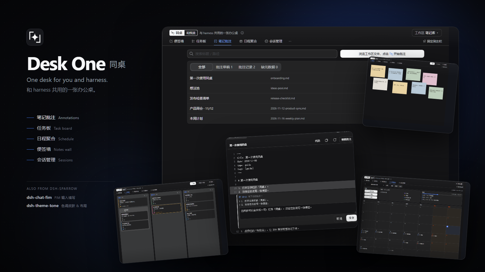
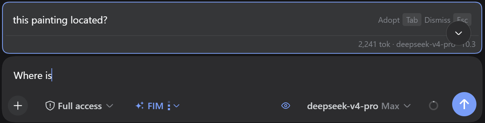
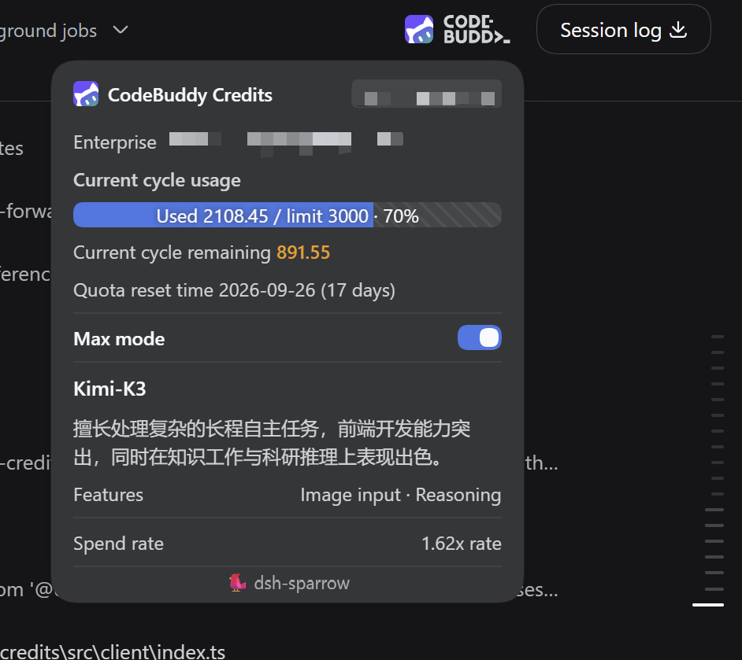
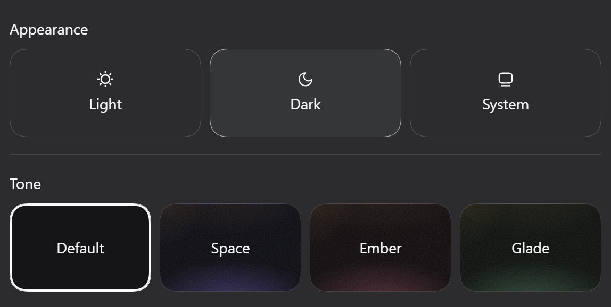
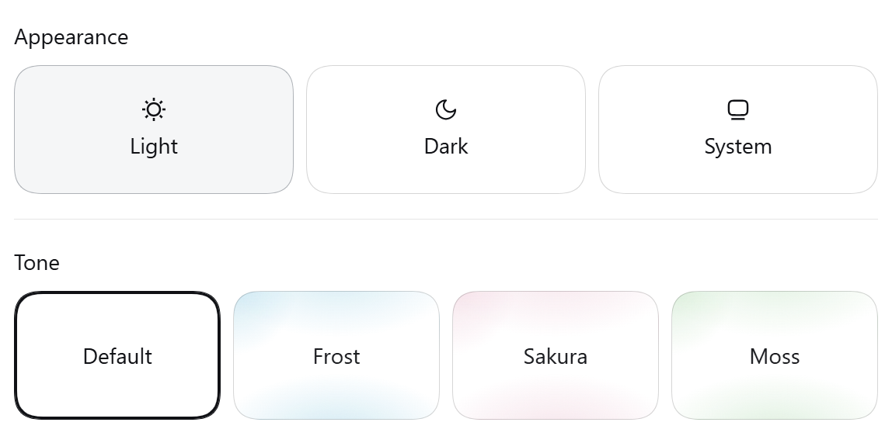

# 🐦dsh-sparrow

[](https://www.npmjs.com/org/dsh-sparrow) [](https://github.com/peiyucn/dsh-sparrow/actions/workflows/ci.yml) [](https://github.com/peiyucn/dsh-sparrow/blob/main/LICENSE)

English | [简体中文](README.zh-CN.md) | [GitHub](https://github.com/peiyucn/dsh-sparrow)

**Desk One (同桌) — one desk for you and harness.**



`dsh plugin --profile web add @dsh-sparrow/dsh-desk-one`

[Desk One docs](plugins/dsh-desk-one/README.md) · [Plugin market](https://dsh.pyai.site/)

Desk One is the desk. The three tools below come with it and install separately; each plugin is published independently and retires once DSH supports its feature natively. The version badge tracks the collection's aligned release line, mirrored from official dsh.

## What's inside the desk

* **Annotations** — link a DSH workspace as the notebook library, browse its Markdown / text files, and annotate exact source lines in a dedicated Session. No editor, no git dependency, no new-note form.
* **Notes** — a free-form sticky wall with in-place editing, drag, resize, colour, layer order and a trash; **Smash!** clears the wall after a confirmation.
* **Tasks** — a three-lane board (To do / Doing / Done) with colour tags, day-granular due dates, pointer dragging, one-level groups and a Done archive.
* **Schedule** — a read-only mirror of WeCom, iCloud and personal Outlook calendars plus public ICS subscriptions, with Start / Today / Upcoming and month / week / list views.
* **Sessions** — one shared agent-session catalog with workspace groups, archive management, a trash and parent / child nesting.
* **Talk to Me** — the header's split **「✦」 Desk One｜Talk to Me** button prefills a tab-aware prompt; nothing is sent until you press send.

## Requirements

* DSH 0.2.2-rc.3 — the exact official version line each release is built and verified against ([deepseek-harness](https://github.com/deepseek-ai/deepseek-harness)); newer version lines, pre-releases in particular, are **not** covered. A plugin that meets an unsupported DSH disables itself with one log line instead of breaking DSH.
* Node.js 24.9 or newer, matching the DSH host requirement.
* A working `dsh` CLI and `pnpm` (`dsh plugin` forwards installation to pnpm).

## Install

> Use `dsh plugin` for every package below. A direct `npm install @dsh-sparrow/...` only downloads the package into a `node_modules`; it does not register it in the DSH web profile. Restart DSH after installing.

* `dsh plugin --profile web add @dsh-sparrow/dsh-desk-one`
* Optional companion tools: install only the ones you want from the table below.
* Tab shortcuts can be pinned from their headers after the panel is open.

## Install from the DSH plugin market

You can also browse and install these from **Plugins → Discover** in DSH (custom plugin markets are experimental: turn on **Custom plugin markets** under **Plugins → Experimental plugins → More** first). Open <https://dsh.pyai.site/> for the index URL and steps; the index URL itself is:

```
https://dsh.pyai.site/market/index.json
```

Paste it into **Discover → Add index source**. The market marks which versions work with the DSH you are running — every plugin here only supports the exact version line its version number states, so the card usually shows the single installable version.

## Plugins

| Plugin | What it does | Install |
| :--- | :--- | :--- |
| [dsh-desk-one](plugins/dsh-desk-one/README.md) | **Desk One** — the desk: annotations, notes, tasks, a read-only schedule and session management in one panel. | `dsh plugin --profile web add @dsh-sparrow/dsh-desk-one` |
| [dsh-chat-fim](plugins/dsh-chat-fim/README.md) [](https://www.npmjs.com/package/@dsh-sparrow/dsh-chat-fim) | <br>Chat input suggestions powered by DeepSeek FIM (Beta): pause to get a suggestion card, Tab adopts; three trigger-sensitivity levels; the completion model follows the main model. | `dsh plugin --profile web add @dsh-sparrow/dsh-chat-fim` |
| [dsh-codebuddy-credits](plugins/dsh-codebuddy-credits/README.md) [](https://www.npmjs.com/package/@dsh-sparrow/dsh-codebuddy-credits) | <br>Company CodeBuddy credits as a DSH LLM provider: each model's credit rate in the model picker, a quota panel in the header, and per-turn credits. | `dsh plugin --profile web add @dsh-sparrow/dsh-codebuddy-credits` |
| [dsh-theme-tone](plugins/dsh-theme-tone/README.md) [](https://www.npmjs.com/package/@dsh-sparrow/dsh-theme-tone) |  <br>Tone skins for DSH's built-in light and dark themes (dark on the left, light on the right), plus conversation-area layout tuning once a tone is picked. | `dsh plugin --profile web add @dsh-sparrow/dsh-theme-tone` |

## Retired

Retired plugins are removed from the source tree; their npm packages keep their published versions (not unpublished):

* `dsh-nav-pin` and `dsh-vision-bridge` — deleted 2026-10-27
* `dsh-file-manage` — deleted 2026-10-31
* `dsh-archive-manage` — retired 2026-11-15

Remove an existing install with `dsh plugin --profile web remove @dsh-sparrow/<plugin>`.

## License

MIT
