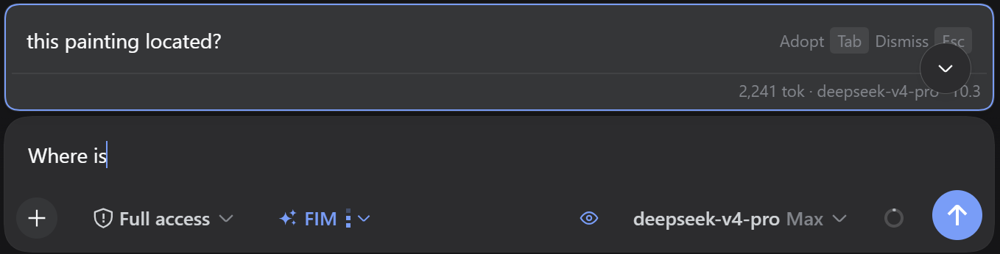

# 🐦dsh-sparrow

[](https://www.npmjs.com/org/dsh-sparrow) [](https://github.com/peiyucn/dsh-sparrow/actions/workflows/ci.yml) [](https://github.com/peiyucn/dsh-sparrow/blob/main/LICENSE)

简体中文 | [English](README.md) | [GitHub](https://github.com/peiyucn/dsh-sparrow)

**同桌（Desk One）—— 和 harness 共用的一张办公桌。**


`dsh plugin --profile web add @dsh-sparrow/dsh-desk-one`

* **一张桌子，不是五个页面。** 便签、任务、日程、批注都在一个侧栏入口后面。
* **和 DSH 一起。** 顶栏「和我说」把一句人话变成预填提示——便签、任务、批注都可以直接说。
* **AI 写、你批注。** 工作区里的任意 Markdown / 文本文件都能直接打开：AI 在里面写，你在专用会话里逐行批注。

[Desk One 文档](plugins/dsh-desk-one/README.zh-CN.md) · [插件市场](https://dsh.pyai.site/)

Desk One 是这张桌子；下面这些工具随桌附送、单独安装。每个插件独立发布，某功能被官方原生支持、或插件不再值得维护时，对应插件从合集中退役。上方版本徽章跟踪合集对齐版本线（镜像官方 dsh）。

## 环境要求

* DSH 0.2.2-rc.3——本版构建与验证所对齐的**确切**官方版本线（[deepseek-harness](https://github.com/deepseek-ai/deepseek-harness)）；更新的版本线、尤其是预发布版本**不在承诺范围内**。插件遇到不支持的 DSH 时会自行停用（日志留一行说明），不会拖垮 DSH。
* Node.js >= 22.19.0
* 可用的 `dsh` CLI 和 `pnpm`（`dsh plugin` 会把安装操作转发给 pnpm）

## 安装

> 这些包虽然发布在 npm，但**不要**直接用 `npm install @dsh-sparrow/...` 安装：那只会把它们下载到某个 `node_modules`，不会注册进 DSH 的 web profile。请使用下面的 `dsh plugin` 命令，让包安装到 `$DSH_HOME/profiles/web` 并激活 bundle 层；安装后请重启 DSH。

## 在 DSH 插件市场里安装

也可以从 DSH 的 **插件 → 发现** 里浏览安装（自定义插件市场是实验性功能：先在 **插件 → 实验性插件 → 更多** 打开「自定义插件市场」）。打开 <https://dsh.pyai.site/> 能看到索引地址与步骤，索引地址是：

```
https://dsh.pyai.site/market/index.json
```

「发现 → 添加索引源」粘贴上面的地址即可。市场会按你当前运行的 DSH 版本标出可用版本——本合集的每个插件只承诺版本线所标示的那一条线，所以卡片上显示的通常就是唯一可装的那个版本。

## 插件目录

| 插件 | 是什么 | 安装 |
| :--- | :--- | :--- |
| [dsh-chat-fim](plugins/dsh-chat-fim/README.zh-CN.md) [](https://www.npmjs.com/package/@dsh-sparrow/dsh-chat-fim) | <br>输入框续写联想：停顿后浮现一张建议卡、Tab 采纳；DeepSeek FIM（Beta）驱动，触发灵敏度三档，续写模型跟随主模型。 | `dsh plugin --profile web add @dsh-sparrow/dsh-chat-fim` |
| [dsh-codebuddy-credits](plugins/dsh-codebuddy-credits/README.zh-CN.md) [](https://www.npmjs.com/package/@dsh-sparrow/dsh-codebuddy-credits) | <br>公司 CodeBuddy 额度接成 DSH LLM provider：模型选择器里显示各模型的积分倍率、顶栏有额度面板、每轮显示消耗的积分。 | `dsh plugin --profile web add @dsh-sparrow/dsh-codebuddy-credits` |
| [dsh-theme-tone](plugins/dsh-theme-tone/README.zh-CN.md) [](https://www.npmjs.com/package/@dsh-sparrow/dsh-theme-tone) |  <br>在 DSH 内置的浅色与深色主题上各加几款色调皮肤（左深右浅），选了色调后还会一并优化对话区布局。 | `dsh plugin --profile web add @dsh-sparrow/dsh-theme-tone` |
| [dsh-desk-one](plugins/dsh-desk-one/README.zh-CN.md) | **同桌（Desk One）**——这张桌子：便签、任务、只读日程，以及 AI 写、你批注的工作区文件，都在一个面板里。 | `dsh plugin --profile web add @dsh-sparrow/dsh-desk-one` |

## 已退役

退役插件会从源码树删除；npm 包保留已发布版本（不作 unpublish）：

* `dsh-nav-pin` 与 `dsh-vision-bridge`——2026-10-27 删除
* `dsh-file-manage`——2026-10-31 删除
* `dsh-archive-manage`——2026-11-15 退役

已安装的可用 `dsh plugin --profile web remove @dsh-sparrow/<插件名>` 卸载。

## License

MIT
