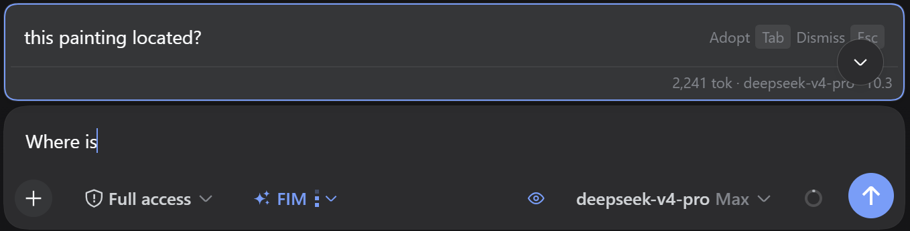

# dsh-chat-fim

简体中文 | [English](README.md) | [GitHub](https://github.com/peiyucn/dsh-sparrow)

聊天输入框续写联想 —— DeepSeek Harness（DSH）Web 插件（dsh-sparrow 合集成员）。

打字停顿片刻，输入框上方会浮现一张建议卡，给出「接下来可能写的文字」：**Tab** 采用进草稿，**Esc** 丢弃。补全由 DeepSeek FIM 补全（Beta）驱动，续写直接站在你的角度接话。

## 安装

打开 **插件 → 添加插件**，输入 `@dsh-sparrow/dsh-chat-fim` 并启用。也可以走 [根 README](../../README.zh-CN.md) 里的共享市场索引流程。

适配 DSH >=0.2.2-rc.3 <0.2.3（0.2.2 线；构建与验证基于 0.2.2-rc.5；更新的版本线、尤其是预发布版本不在承诺范围内）。

> 请通过 DSH 插件管理器安装。直接用 npm 安装不会注册进 DSH 的 web profile；安装后重启 DSH。

## 使用

* **开关**：输入框工具行的「✦ FIM」开关，点击开 / 关；**默认关闭**，开启状态本地记忆
* **触发**：开启后打字停顿自动联想；**句末标点（`。！？.!?;；`）结尾仅「高」档触发**（中/低不触发），拼音等输入法组合输入中不触发；其余规则（停顿时长、最短草稿、夹入英文半词、词后空格、句末标点）随下方灵敏度三档伸缩
* **建议**：Tab 采用、Esc 丢弃（也可直接点选）；@/斜杠候选菜单打开时本建议自动让位；**每次建议只有一句**（续写到句末标点即止），想连续续写就连续按 Tab——触发更勤可切「高」档
* **触发灵敏度**：开关右侧「点 + ▾」触发区可选**高 / 中 / 低**三档（点击整区只开选档菜单、不会误触开关；恒显 3 个点、自下而上点亮 3/2/1 个指示当前档，悬停有提示），续写模型**跟随你选择的主模型**（deepseek-flash / v4-pro / v4-flash；vision 等回退 deepseek-flash）。三档规则：

  | 档位 | 停顿 | 最短草稿 | 夹入英文半词 | 词后空格 | 句末标点 |
  |---|---|---|---|---|---|
  | 高 | 250ms | 中文 4 字 / 英文 2 字符 | 联想 | 联想 | 联想 |
  | 中（默认） | 400ms | 中文 8 字 / 英文 6 字符 | 不联想 | 联想 | 不联想 |
  | 低 | 800ms | 中文 12 字 / 英文 8 字符 | 不联想 | 不联想 | 不联想 |

* 当前会话主模型不是 DeepSeek 系列时，开关整体隐藏
* **限制**：dsh 判不了主模型是否受支持时（例如刚启动、会话尚未激活），开关最晚约 15.5s 后按可见兜底——这期间非 DeepSeek 模型也可能显示开关
* **凭据**：续写请求复用你在 dsh 中配置的 DeepSeek API key（FIM 补全 Beta），不新增凭据、key 不进浏览器；产生的 token 计入你的 DeepSeek 账户

## 截图

## 卸载与残留

* 插件不写任何文件、不改 `.dsh` 内部结构，只做网络转发；
* 唯一的持久状态是浏览器 localStorage 键 `dsh-chat-fim:enabled`（开关）与 `dsh-chat-fim:sensitivity`（触发灵敏度）。卸载后这两个键留在浏览器里、无害，介意可在 DevTools 中删除。

**更新日志**：[CHANGELOG.zh-CN.md](https://github.com/peiyucn/dsh-sparrow/blob/main/plugins/dsh-chat-fim/CHANGELOG.zh-CN.md)
