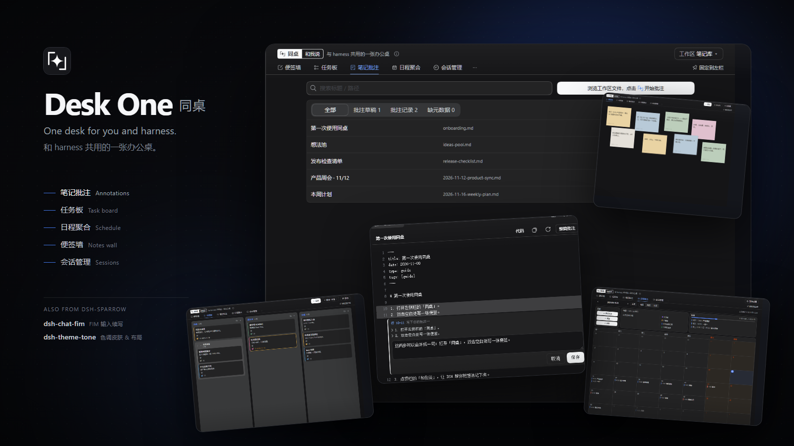

# Desk One (同桌)

English | [简体中文](README.zh-CN.md)

**One desk for you and harness.**

`dsh plugin --profile web add @dsh-sparrow/dsh-desk-one`

**Desk One (同桌)** — a shared desk for you and harness inside the DSH web UI: one sidebar entry, one panel, and one shared object model behind every tab. Annotations, notes, tasks, schedule and agent sessions live side by side; the schedule aggregates WeCom / iCloud / personal Outlook calendars (read-only). The header's split **「✦」 Desk One｜Talk to Me** button sends a tab-aware prefilled prompt into the conversation; the empty notes wall offers a "note this down…" entry, and the empty To-do lane repeats the same wording as plain text, with no click action. The "…" menu at the end of the tab strip also has **Make a wish**: describe a feature and it becomes a GitHub issue draft.

## What it is

* One left-sidebar entry named **Desk One**; functions live in tabs inside the panel instead of scattering across the UI. The panel chrome follows the official conversation header, and in-page action buttons reuse the official plugin-page button shape.
* **Annotations** is “AI writes, you annotate”: link a DSH workspace as the notebook library, browse / search its Markdown and text files, and open any page in a dedicated annotation Session — exact source lines, submit annotations into the composer, and this round's diff against a per-Session baseline. The linked workspace can be switched from the bar at the top of the page; no unlink round-trip, no new-note creation. No editor and no git dependency.
* **Notes** is the sticky-note wall: a free-form canvas, not an input form.
* **Tasks** is the three-lane board (To do / Doing / Done) with colour tags, day-granular due dates, drag-to-move, groups and an archive.
* **Schedule** leads the tab strip and aggregates WeCom, iCloud and personal Outlook (Microsoft Graph) calendars plus public ICS subscriptions into one read-only page: a Start / Today / Upcoming top row, a month / week / calendar calendar below (month by default, Monday-first; week shows its ISO week number (`W46`) in the top-left corner and has a 0–24 hour ruler on the left, 8 hours per screen with scrolling), an event card anchored at the click, and a full calendar-source management page opened from the top-bar **Calendar settings** action, which also hosts manual sync; the calendar-settings, notes-trash and task-archive sub-pages share one title/count header and type scale, and keep their back button in the top-right header slot (per-source cards: WeCom / iCloud CalDAV, Outlook via Microsoft Graph, and provider-agnostic ICS subscriptions).
* **Sessions** is the shared agent-session catalog: active sessions grouped by workspace, plus archive management (unarchive, move to trash, restore, permanent delete, stray sessions) with typed-title confirmation for destructive actions. The panel header matches the conversation topbar: a compact 76px bar (solid official black/white by default; glass only when theme-tone is active) with the brand title plus a one-line intro and the active view actions, followed by official-style plain text tabs (2px underline on the active tab) and a trailing ellipsis launcher (official `More` button) that opens a blurred page menu; future tabs can move there instead of growing the strip. It is a fixed 76px overlay; every feature keeps a 76px content offset so the first paint starts below the glass while scrolling content passes underneath. The notes wall is full-bleed, and the trailing ellipsis opens a floating blurred page menu.

## Requirements

* Requires DSH 0.2.2-rc.3, the exact version line the other plugins in this repository pin.
* Node.js 24 or newer, matching the DSH host requirement.
* Notes, tasks and session management need no network or account setup. **Schedule aggregation** requires connecting at least one source in the panel (WeCom CalDAV sync password, iCloud app-specific password, or a personal Outlook account signed in with Microsoft Graph) and lets the host reach that service. Public ICS subscriptions can be added from the same settings page.

## Install

* `dsh plugin --profile web add @dsh-sparrow/dsh-desk-one`
* Restart dsh web after installing; a browser refresh alone is not enough for the client bundle.
* Then open the whale sidebar and pick **Desk One** (a single entry by default; use **Pin to sidebar** in a tab header if you want a direct shortcut).

## Use

* Desk One keeps a single left-rail entry by default; each tab header has an **Pin to sidebar** / **Unpin from sidebar** button that adds or removes that tab's own sidebar entry live, persisted across restarts. Leave it alone unless you want a shortcut.
* **Annotations** is “AI writes, you annotate”: link a DSH workspace as the notebook library and the **Annotations** tab lists its Markdown / text files with the official search field and four views (All / Annotation drafts / Annotation records / Missing metadata), 20 rows per page in the compact single-line list. The linked workspace sits in a bar at the top of the page (`Current workspace ▾`) and can be switched at any time — pick another registered workspace, choose a folder inside one, create a new workspace, or clear the link; there is no unlink round-trip and no new-note creation. Opening a page starts (or reuses) that note's annotation Session: exact source line numbers, MD / code switch, an Annotate button on selection with the comment box inline, the two split buttons (Submit annotations / This round's changes), a per-Session round baseline, and the official-blue **✦** mark in the sidebar. The official file preview header gets the same ghost **✦** button for **any Markdown / text file inside a registered workspace**, not only the linked library; it opens that file's annotation view (reusing an openable Session, otherwise starting one in the file's workspace). No editor, no git dependency; the only bundled skill is the Desk One operating guide.

* Tap **Note** in the title-row actions or double-click empty space on the wall: a fresh sticky appears at that spot, lands on top of the pile and takes the keyboard focus. The command row also hosts **Smash!** and the trash entry; the empty wall keeps its faint two-line hint.
* The wall is a fixed-width, vertically infinite canvas: notes can live below the viewport and the wall scrolls vertically to them. Dragging does not auto-scroll the wall — scroll to the spot first, then drag the sticky (it keeps following the pointer at any scroll position).
* Type straight onto the sticky; leaving it saves the text, and an emptied sticky is removed instead of kept as clutter.
* Drag a sticky by its body; a compact six-dot grip at the top-left marks the grab area. Whichever sticky you click or drag comes to the front, and that layer order is saved too.
* Drag the bottom-right corner of a sticky to change its size; position and size are saved per note.
* Hover a sticky to reveal its color dots and the small icon actions. The tab you were on is remembered when you come back to Desk One.
* The small **trash icon** on a sticky drops it into the trash without deleting it (with the same short fly-away animation as Smash); the trash button — separated from the wall actions by a hairline divider — opens the trash view, where a note can be restored or deleted permanently. The wall holds at most **100** notes and the trash at most **200**; the trash view shows the total and renders 10 rows at a time with **Load more**. No badge sits on the trash button — only genuinely unread things deserve that attention.
* **Smash!** is the red frosted-glass icon button next to **＋**: after a two-step confirmation it moves every sticky on the wall into the trash with a short fly-away animation. It is always visible and simply does nothing when the wall is empty; clicking anywhere else or pressing **Esc** cancels the confirmation. It is blocked when the trash cannot hold them all.
* Open **Tasks** for the fixed three-lane board. Add a card with a lane's **＋** or by double-clicking empty space in a lane; the card shows a wrapping title and description, a stacked colour swatch (current colour on top with palette neighbours peeking out; clicking opens a five-colour palette), and a calendar button for the day-granular deadline (icon only when unset, icon + date once set; click to change it). Click the title or description to edit it; the text is plain otherwise, so the **whole card is a drag surface**. Cards due within a day get an amber outline, overdue dates show in red, and only cards and groups in **Done** can be archived.
* Press anywhere on a card to drag it: a copy follows the pointer, lanes highlight, and dropping it on an invalid spot flies the card back. Drop a card into a lane to change status or onto another card to reorder; while dragging, the target lane and group light up and a blue insertion line shows exactly where it will land. Delete asks for a second click.
* The title-row actions switch between **manual order**, **creation time** and **due date**. **＋ group** creates a real one-level group inside a lane: cards can be dragged in or out, the group can stay empty, its name can be edited in place, and the six-dot grip reorders groups. Its header uses two rows (name, then task count) so long names and the action icons fit a narrow lane. Ungrouped cards and group blocks share **one manual sequence**, so a group can be dropped between cards (and cards between groups). Dragging a group by its header moves the whole block just like a card — the header and its cards follow the pointer, dropping it on another lane moves its cards with it immediately (moving back is just as cheap), and a drop inside the same lane reorders groups. Deleting a group keeps its cards and makes them ungrouped. In the **Done** lane a group header also gets an archive button: archiving takes the whole group and its cards off the board, the archive view lists it as one row, restoring brings both back, and deleting an archived group removes its cards too. **Archived** lists archived tasks where they can be restored or deleted permanently.
* Open **Sessions** for the shared agent-session catalog: active, archived, stray and trash sections share one row layout and icon actions; active uses a soft success outline while the others stay neutral grey; parent/child sessions render as nested groups with actions on the parent only, and children always follow it. Active rows offer light archive only (it goes through the official archive API and never touches files; a session with running activity is refused by the official activity gate, so stop generation first); move-to-trash and delete live in the archived and trash sections. Archived rows can be unarchived, moved to trash or deleted forever (a parent takes its children with it); the trash supports expanding lineage, restore / restore all / permanent delete and shows a copyable path. Deleting a regular session requires typing its exact title, and blank strays plus bulk actions use their own two-step confirmation. Every row also shows copy-name and copy-session-id icon buttons whose result is reported on the button itself. Every section loads 30 rows at a time.
* Open **Schedule** for the aggregated calendar: the top row is three centred columns: a narrow **Start** card stacking narrow-but-tall **+ Annotate / + Note / + Task** white primary buttons, plus Today and Upcoming at equal width. Today puts its title and date on one line and splits into today's events (left) and four colourful clickable counts (events / notes / unfinished tasks / active sessions, right) with a hairline divider, both columns top-aligned — the "N events" count opens the full calendar list; Upcoming shows its date range on the title line above a 1–14 day slider and its events. **Calendar settings** in the shared top bar opens the full source management page; the month / week / calendar view fills the rest (month by default, Monday-first, 5–6 rows as needed; week shows its ISO week number in the corner and has a 0–24 hour ruler with 8 hours per screen and scrolling). Click an event for a card near the cursor and click elsewhere or press Esc to close. External events are read-only: copy them or jump back to the original client. The panel syncs on open and then every 15 minutes; a narrow panel reflows the three top cards (two columns / one column) instead of squeezing them; the top row and the calendar below share the same 1100px centred maximum width. Sync failures no longer surface on the calendar page: the top-bar **Calendar settings** action gets a red exclamation badge, and the settings page shows the exact error inside the failing source card (red dot = source failed, amber = some calendars failed).
* Nothing scrolls sideways: when the panel gets too narrow the three lanes collapse into count-only columns (lane name plus per-group counts). When a lane's cards overflow vertically, its body shows a thin scrollbar and scrolls instead of squeezing the cards.
* Link DSH sessions to a card with **@** — a card can carry several sessions and one session can serve several cards. Each session chip carries its live state as colour (available sessions are green; archived/unavailable ones are neutral grey) and a slow orbiting green ring marks the ones where the agent is actually running (it stays still under reduced-motion). Click a chip to expand it in place, up to the card width (the card height may grow, and a running chip keeps its animated border around the expanded box): last run, model time, turns, steps and token usage appear inside, click elsewhere restores it, and the arrow opens the session. The **@** entry sits on its own row below the linked chips; its picker is a floating panel over the whole page (never clipped by the lane) and lists the same session set as the composer's `@` menu, including subagent sessions. Linking never overwrites the card's own title or description.

## Data and privacy

* Notes, tasks, the schedule mirror and annotation records live in a DSH storage domain (`desk_one`) managed by the official storage service; the schedule is a read-only mirror and is never written back.
* Schedule credentials (sync password / OAuth refresh token / subscription link) live only in the official credential store (`ctx.credentials`); records keep only a reference name, and nothing is written to logs, HTML or exports.
* The panel talks to the plugin's own host routes under `/api/desk-one` (sessions under `/api/desk-one/sessions/*`, schedule under `/api/desk-one/schedule/*`, annotations under `/api/desk-one/notebook/*`); the client never touches storage directly.
* Agent tools (`desk_note_*`, `desk_task_*`, `desk_group_*`, `desk_schedule_*`, `desk_page_list`) read and write the same objects; a bundled `desk-one` operating guide skill (on by default, also in `/`) covers object choice and the revision workflow, including the read-only `desk_page_list` page search; the session index stores only FK metadata (never transcripts) for task/session edges, so the model and the UI always see one dataset. Session links store only opaque session ids next to your local data; their titles and running state are read from the host UI and never sent anywhere.

## Known limitations

* The schedule is a **read-only** aggregation: no local event creation, no write-back, and no publishing/exporting your own calendar as an iCalendar feed; subscribing to public ICS links is supported. The sources must be configured by you on first use, and their protocol behaviour is owned by the official services.
* Schedule aggregation is bounded by those services: re-issuing the WeCom sync password invalidates the old one; iCloud app-specific passwords are all revoked when the Apple account password changes; Outlook access depends on Microsoft Graph sign-in and may need re-authorisation.
* While the standalone archive plugin still exists it shares the same trash directory; after it retires, archive and trash management live only in Desk One.
* Focus sessions, search and richer task fields (priority, estimates, labels) are planned in the repository spec.
* Task drag is pointer-only; there is no keyboard reorder yet.
* Session links are display and navigation only for now: the board never advances a card when a session starts or ends.
* Notes created by agent tools get an automatic wall position until you drag them yourself.
* Saved positions are re-clamped on screen while the window is small, and return to their saved spots once there is room again.

## Development

* Plugin-level check: `npm run verify` inside this directory (typecheck, build, tests, pack check).
* Repository-level check: `pnpm run verify` at the repository root.
